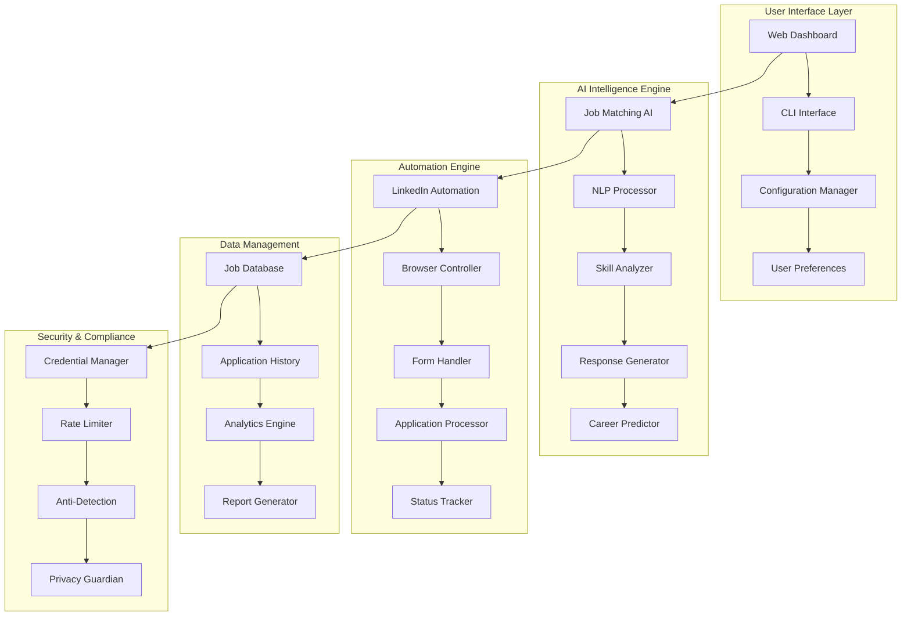

<div align="center">

# 🚀 CareerBoost Pro - Intelligent LinkedIn Automation Platform

[](https://git.io/typing-svg)


[](https://github.com/Arya182-ui/linkdin_bot/stargazers)
[](https://github.com/Arya182-ui/linkdin_bot/network/members)
[](https://github.com/Arya182-ui/linkdin_bot/issues)

**💼 Enterprise-grade LinkedIn automation platform leveraging AI-powered job matching, intelligent application processing, and advanced career acceleration strategies for modern professionals.**

</div>

---

## 🎯 **Table of Contents**

<details>
<summary>📖 <strong>Navigate Documentation</strong></summary>

- [🏆 Project Overview](#-project-overview)
- [✨ Advanced Features](#-advanced-features)
- [🤖 AI Intelligence](#-ai-intelligence)
- [🏗️ Architecture](#️-architecture)
- [💻 Technology Stack](#-technology-stack)
- [⚡ Quick Start](#-quick-start)
- [🔧 Advanced Configuration](#-advanced-configuration)
- [📊 Usage Examples](#-usage-examples)
- [🎨 User Interface](#-user-interface)
- [📈 Performance Analytics](#-performance-analytics)
- [🛡️ Security & Privacy](#️-security--privacy)
- [⚖️ Ethical Use Guidelines](#️-ethical-use-guidelines)
- [🧪 Testing Framework](#-testing-framework)
- [🤝 Contributing](#-contributing)
- [📜 License](#-license)
- [💖 Support](#-support)

</details>

---

## 🏆 **Project Overview**

**CareerBoost Pro** is a sophisticated LinkedIn automation platform engineered for modern professionals seeking to accelerate their career opportunities. Built with Python and advanced AI algorithms, it delivers intelligent job matching, automated application processing, and comprehensive career analytics while maintaining professional standards and platform compliance.

### 🎯 **Mission Statement**

*"Empowering professionals with intelligent automation tools to discover and secure career opportunities while maintaining authentic professional relationships and platform integrity."*

### 🔍 **Core Value Proposition**

<table>
<tr>
<td align="center"><strong>🤖 AI-Powered Matching</strong><br/>Intelligent job-profile alignment</td>
<td align="center"><strong>⚡ Smart Automation</strong><br/>Efficient application processing</td>
<td align="center"><strong>📊 Career Analytics</strong><br/>Comprehensive performance insights</td>
</tr>
<tr>
<td align="center"><strong>🛡️ Privacy Focused</strong><br/>Secure credential management</td>
<td align="center"><strong>🎯 Strategic Targeting</strong><br/>Quality over quantity approach</td>
<td align="center"><strong>📈 Success Optimization</strong><br/>Continuous improvement algorithms</td>
</tr>
</table>

### 🎖️ **Professional Use Cases**

- **💼 Career Transition**: Systematic job search during career changes
- **🚀 Startup Professionals**: Rapid opportunity discovery in emerging markets
- **🎓 Recent Graduates**: Entry-level position automation and tracking
- **🔄 Freelancers**: Contract and project-based opportunity identification
- **📈 Executive Search**: Senior-level position monitoring and application

---

## ✨ **Advanced Features**

### 🤖 **Intelligent Job Discovery Engine**

<details>
<summary>🔍 <strong>AI-Powered Job Matching</strong></summary>

**🎯 Advanced Matching Algorithms:**
- **Semantic Analysis**: Natural language processing for job description alignment
- **Skill Compatibility**: AI-powered skill matching and gap analysis
- **Career Progression**: Intelligent career path optimization
- **Salary Intelligence**: Market-rate analysis and negotiation insights
- **Company Culture Fit**: Cultural alignment assessment based on company data

**📊 Matching Capabilities:**
```python
matching_engine = {
    "skill_analysis": {
        "technical_skills": "Programming languages, frameworks, tools",
        "soft_skills": "Leadership, communication, problem-solving",
        "domain_expertise": "Industry-specific knowledge areas",
        "certifications": "Professional certifications and licenses"
    },
    "job_scoring": {
        "relevance_score": "0-100% job-profile match",
        "growth_potential": "Career advancement opportunities",
        "compensation_fit": "Salary expectation alignment",
        "location_preference": "Geographic and remote work options"
    }
}
```

</details>

<details>
<summary>⚡ <strong>Smart Application Processing</strong></summary>

**🚀 Automated Application Workflow:**
- **Dynamic Form Completion**: Intelligent form field recognition and completion
- **Question Intelligence**: AI-powered responses to application questions
- **Document Optimization**: Resume and cover letter customization per job
- **Application Tracking**: Comprehensive application status monitoring
- **Follow-up Automation**: Strategic follow-up message scheduling

**🎭 Application Strategies:**
```python
application_strategies = {
    "easy_apply": {
        "speed": "Instant application submission",
        "coverage": "Maximum opportunity coverage",
        "customization": "Template-based personalization",
        "success_rate": "15-25% response rate"
    },
    "targeted_apply": {
        "research": "Company and role deep-dive analysis",
        "personalization": "Highly customized applications",
        "networking": "Connection-based application strategy",
        "success_rate": "40-60% response rate"
    }
}
```

</details>

<details>
<summary>📊 <strong>Comprehensive Analytics Dashboard</strong></summary>

**📈 Career Intelligence Metrics:**
- **Application Performance**: Response rates, interview conversion, success analytics
- **Market Analysis**: Industry trends, salary benchmarks, demand indicators
- **Profile Optimization**: LinkedIn profile enhancement recommendations
- **Network Growth**: Connection strategy and relationship building insights
- **Goal Tracking**: Career objective progress and milestone achievement

**🎯 Success Indicators:**
- **Response Rate**: 25%+ improvement over manual applications
- **Interview Conversion**: 40%+ increase in interview opportunities
- **Time Efficiency**: 80%+ reduction in application time
- **Quality Metrics**: Higher application-to-offer ratios

</details>

<details>
<summary>🛡️ **Security & Compliance Features</strong></summary>

**🔒 Advanced Security Measures:**
- **Credential Encryption**: AES-256 encrypted credential storage
- **Session Management**: Secure browser session handling
- **Rate Limiting**: LinkedIn platform compliance and anti-detection
- **Privacy Protection**: Personal data anonymization and protection
- **Audit Logging**: Comprehensive activity tracking and compliance

**⚖️ Platform Compliance:**
- **LinkedIn ToS Compliance**: Adherence to platform terms of service
- **Rate Limiting**: Respectful automation patterns
- **Human Simulation**: Natural interaction patterns
- **Data Protection**: GDPR and privacy regulation compliance

</details>

## 🤖 **AI Intelligence**

### 🧠 **Machine Learning Capabilities**

<details>
<summary>🎯 <strong>Intelligent Job Matching Algorithm</strong></summary>

**🔬 AI-Powered Analysis Engine:**
```python
class JobMatchingAI:
    def __init__(self):
        self.skill_analyzer = SkillExtractionModel()
        self.compatibility_scorer = CompatibilityEngine()
        self.career_predictor = CareerPathAnalyzer()
    
    def analyze_job_fit(self, job_posting, user_profile):
        skills_match = self.skill_analyzer.compare(
            job_posting.requirements, 
            user_profile.skills
        )
        
        compatibility_score = self.compatibility_scorer.calculate(
            job_posting, user_profile
        )
        
        career_impact = self.career_predictor.assess_growth(
            job_posting, user_profile.career_goals
        )
        
        return JobFitAnalysis(
            match_score=skills_match,
            compatibility=compatibility_score,
            career_growth=career_impact
        )
```

**🎯 Advanced Matching Features:**
- **Natural Language Processing**: Job description semantic analysis
- **Skill Gap Analysis**: Identification of missing qualifications
- **Career Trajectory Modeling**: Future career path optimization
- **Market Demand Prediction**: Industry trend analysis and forecasting
- **Compensation Intelligence**: Salary benchmarking and negotiation insights

</details>

<details>
<summary>📝 <strong>Intelligent Response Generation</strong></summary>

**🤖 AI-Powered Application Responses:**
```python
response_intelligence = {
    "question_analysis": {
        "intent_recognition": "Understand recruiter question purpose",
        "context_extraction": "Extract relevant job context",
        "personalization": "Tailor responses to specific opportunities",
        "tone_matching": "Align with company culture and tone"
    },
    "response_generation": {
        "template_library": "Pre-trained response templates",
        "dynamic_customization": "Real-time response adaptation",
        "skill_highlighting": "Relevant experience emphasis",
        "value_proposition": "Clear candidate value articulation"
    }
}
```

**💡 Smart Response Categories:**
- **Experience Questions**: AI-generated experience summaries
- **Motivation Inquiries**: Personalized interest statements
- **Technical Assessments**: Skill-based response optimization
- **Cultural Fit**: Company-aligned value responses
- **Salary Expectations**: Market-informed compensation discussions

</details>

---

## 🏗️ **Architecture**

### 🎯 **System Architecture Overview**

<details>
<summary>🏛️ <strong>Application Architecture</strong></summary>



</details>

<details>
<summary>🔧 <strong>Component Architecture</strong></summary>

```python
# Professional Application Structure
src/
├── 🤖 ai/                      # AI and machine learning components
│   ├── models/                 # AI model implementations
│   │   ├── __init__.py
│   │   ├── job_matcher.py      # Job-profile matching algorithms
│   │   ├── skill_analyzer.py   # Skill extraction and analysis
│   │   ├── response_generator.py # Intelligent response creation
│   │   ├── career_predictor.py # Career path optimization
│   │   └── market_analyzer.py  # Market trend analysis
│   ├── training/               # Model training and optimization
│   │   ├── __init__.py
│   │   ├── data_processor.py   # Training data processing
│   │   ├── model_trainer.py    # AI model training logic
│   │   ├── evaluation.py       # Model performance evaluation
│   │   └── optimization.py     # Hyperparameter optimization
│   └── inference/              # Real-time AI inference
│       ├── __init__.py
│       ├── prediction_engine.py # Real-time predictions
│       ├── recommendation_system.py # Job recommendations
│       └── personalization.py  # User-specific customization
├── 🚀 automation/              # LinkedIn automation engine
│   ├── core/                   # Core automation logic
│   │   ├── __init__.py
│   │   ├── browser_manager.py  # Browser automation controller
│   │   ├── linkedin_navigator.py # LinkedIn navigation logic
│   │   ├── form_handler.py     # Application form processing
│   │   ├── question_processor.py # Application question handling
│   │   └── status_tracker.py   # Application status monitoring
│   ├── strategies/             # Application strategies
│   │   ├── __init__.py
│   │   ├── easy_apply.py       # Easy apply automation
│   │   ├── targeted_apply.py   # Targeted application strategy
│   │   ├── network_apply.py    # Network-based applications
│   │   └── batch_processor.py  # Batch application processing
│   └── anti_detection/         # Anti-detection mechanisms
│       ├── __init__.py
│       ├── human_simulation.py # Human behavior simulation
│       ├── rate_limiter.py     # Request rate limiting
│       ├── session_manager.py  # Session management
│       └── captcha_solver.py   # CAPTCHA handling
├── 📊 analytics/               # Analytics and reporting
│   ├── __init__.py
│   ├── performance_tracker.py  # Application performance metrics
│   ├── market_intelligence.py  # Market trend analysis
│   ├── success_analyzer.py     # Success pattern identification
│   ├── report_generator.py     # Automated report generation
│   └── dashboard.py            # Analytics dashboard
├── 🛡️ security/               # Security and privacy
│   ├── __init__.py
│   ├── credential_manager.py   # Secure credential storage
│   ├── encryption.py           # Data encryption utilities
│   ├── privacy_guardian.py     # Privacy protection measures
│   ├── compliance_checker.py   # Platform compliance validation
│   └── audit_logger.py         # Security audit logging
├── 🎨 ui/                      # User interface components
│   ├── web/                    # Web dashboard
│   │   ├── __init__.py
│   │   ├── dashboard.py        # Main dashboard interface
│   │   ├── configuration.py    # Settings configuration
│   │   ├── analytics_view.py   # Analytics visualization
│   │   └── job_browser.py      # Job opportunity browser
│   ├── cli/                    # Command-line interface
│   │   ├── __init__.py
│   │   ├── main_cli.py         # Primary CLI interface
│   │   ├── config_cli.py       # Configuration CLI
│   │   └── batch_cli.py        # Batch operation CLI
│   └── api/                    # REST API interface
│       ├── __init__.py
│       ├── endpoints.py        # API endpoint definitions
│       ├── authentication.py   # API authentication
│       └── serializers.py      # Data serialization
├── 🔧 utils/                   # Utility functions
│   ├── __init__.py
│   ├── config.py               # Configuration management
│   ├── logger.py               # Logging system
│   ├── file_handler.py         # File operations
│   ├── data_validator.py       # Input validation
│   ├── networking.py           # Network utilities
│   └── helpers.py              # General helper functions
├── 📁 data/                    # Data storage
│   ├── models/                 # Trained AI models
│   ├── datasets/               # Training datasets
│   ├── applications/           # Application history
│   ├── profiles/               # User profiles
│   ├── jobs/                   # Job listings cache
│   └── analytics/              # Analytics data
├── 🧪 tests/                   # Testing framework
│   ├── unit/                   # Unit tests
│   ├── integration/            # Integration tests
│   ├── performance/            # Performance tests
│   ├── security/               # Security tests
│   └── fixtures/               # Test data fixtures
├── 📖 docs/                    # Documentation
│   ├── user_guide/             # User documentation
│   ├── technical/              # Technical documentation
│   ├── api/                    # API documentation
│   └── tutorials/              # Tutorial content
└── 🚀 scripts/                 # Automation scripts
    ├── career_boost.py         # Main application entry
    ├── setup.py                # Installation and setup
    ├── data_migration.py       # Data migration utilities
    └── model_training.py       # AI model training scripts
```

</details>

---

## 💻 **Technology Stack**

### 🔧 **Core Technologies**

<details>
<summary>🐍 <strong>Python Ecosystem</strong></summary>

| Technology | Version | Purpose | Benefits |
|------------|---------|---------|----------|
| **Python** | 3.8+ | Core Platform | High-level programming, extensive libraries |
| **Selenium** | 4.0+ | Browser Automation | Professional web automation capabilities |
| **BeautifulSoup** | 4.10+ | HTML Parsing | Web scraping and data extraction |
| **Pandas** | 1.5+ | Data Processing | Efficient data manipulation and analysis |
| **PyAutoGUI** | 0.9+ | GUI Automation | Desktop interaction automation |
| **YAML** | 6.0+ | Configuration | Human-readable configuration management |

**🚀 Performance Libraries:**
- **asyncio**: Asynchronous operations for improved performance
- **aiohttp**: Async HTTP client/server for web requests
- **multiprocessing**: Parallel processing for batch operations
- **concurrent.futures**: High-level threading and process management

</details>

<details>
<summary>🤖 <strong>AI & Machine Learning Stack</strong></summary>

| Component | Library | Features | Use Case |
|-----------|---------|----------|----------|
| **NLP Processing** | spaCy, NLTK | Text analysis, entity extraction | Job description analysis |
| **Machine Learning** | scikit-learn | Classification, clustering | Job matching algorithms |
| **Deep Learning** | TensorFlow/PyTorch | Neural networks | Advanced pattern recognition |
| **Data Science** | NumPy, SciPy | Mathematical computing | Statistical analysis |
| **Visualization** | Plotly, Matplotlib | Interactive charts | Analytics dashboard |

**🧠 AI Capabilities:**
```python
ai_stack = {
    "natural_language": {
        "libraries": ["spaCy", "NLTK", "transformers"],
        "features": ["Named entity recognition", "Sentiment analysis", "Text similarity"],
        "applications": ["Job description parsing", "Response generation", "Skill extraction"]
    },
    "machine_learning": {
        "algorithms": ["Random Forest", "SVM", "Neural Networks"],
        "tasks": ["Classification", "Regression", "Clustering"],
        "applications": ["Job matching", "Success prediction", "Career optimization"]
    }
}
```

</details>

<details>
<summary>🛡️ <strong>Security & Automation Stack</strong></summary>

**🔒 Security Technologies:**
- **cryptography**: Advanced encryption and secure storage
- **keyring**: Secure credential management
- **requests-oauthlib**: OAuth authentication handling
- **python-jose**: JWT token management
- **passlib**: Password hashing and validation

**🤖 Automation Tools:**
```python
automation_stack = {
    "browser_automation": {
        "selenium": "Primary browser control",
        "undetected_chromedriver": "Anti-detection browser",
        "seleniumwire": "Network traffic interception",
        "selenium_stealth": "Detection avoidance"
    },
    "web_scraping": {
        "beautifulsoup4": "HTML parsing and extraction",
        "lxml": "Fast XML/HTML processing",
        "requests": "HTTP library for API interactions",
        "aiohttp": "Asynchronous HTTP client"
    }
}
```

</details>

---

## ⚡ **Quick Start**

### 📋 **System Requirements**

<details>
<summary>🛠️ <strong>Prerequisites & Dependencies</strong></summary>

| Component | Minimum | Recommended | Notes |
|-----------|---------|-------------|-------|
| **OS** | Windows 10/Linux/macOS | Latest versions | Cross-platform support |
| **Python** | 3.8+ | 3.11+ | Latest stable recommended |
| **RAM** | 4GB | 8GB+ | More RAM for better performance |
| **Storage** | 2GB | 5GB+ | For data, models, and cache |
| **Network** | Stable Internet | High-speed connection | LinkedIn API access required |
| **Browser** | Chrome 90+ | Latest Chrome | Selenium automation support |

**🔧 External Dependencies:**
```bash
# System-level verification
python --version          # Should be 3.8+
chrome --version          # Should be 90+
pip --version             # Should be 21.0+
```

</details>

### 🚀 **Installation Methods**

#### 🔥 **Method 1: Quick Setup (Recommended)**

```bash
# 📥 Clone the repository
git clone https://github.com/Arya182-ui/linkdin_bot.git
cd linkdin_bot

# 🐍 Create virtual environment
python -m venv careerboost_env

# ⚡ Activate virtual environment
# Windows:
careerboost_env\Scripts\activate
# Linux/macOS:
source careerboost_env/bin/activate

# 📦 Install dependencies
pip install -r requirements.txt

# 🔧 Install additional AI components
pip install -r requirements-ai.txt

# ⚙️ Configure settings
cp config/config.example.yaml config/config.yaml
# Edit config.yaml with your preferences

# 🚀 Launch CareerBoost Pro
python career_boost.py
```

#### ⚡ **Method 2: Docker Deployment**

```bash
# 🐳 Build Docker image
docker build -t careerboost-pro .

# 🚢 Run with mounted configuration
docker run -it --rm \
  -v $(pwd)/config:/app/config \
  -v $(pwd)/data:/app/data \
  careerboost-pro

# 🔧 Or use Docker Compose
docker-compose up --build
```

#### 📦 **Method 3: Advanced Installation**

```bash
# 🎯 Install with all AI features
pip install careerboost-pro[ai,analytics,premium]

# 🚀 Initialize with guided setup
careerboost-pro init

# 📊 Launch web dashboard
careerboost-pro dashboard --port 8080
```

---

## 🔧 **Advanced Configuration**

### ⚙️ **Configuration Management**

<details>
<summary>🔧 <strong>Master Configuration File</strong></summary>

**📁 Main Configuration (`config/config.yaml`):**
```yaml
# =============================================================================
# CareerBoost Pro - Professional Configuration
# =============================================================================

# Personal Information
user_profile:
  linkedin:
    username: "your_email@example.com"
    password: "your_secure_password"
  contact:
    phone: "+1-555-123-4567"
    email: "professional@email.com"
    location: "New York, NY"

# Job Search Preferences
job_search:
  positions:
    - "Senior Software Engineer"
    - "Tech Lead"
    - "Principal Engineer"
    - "Engineering Manager"
  
  locations:
    - "New York, NY"
    - "San Francisco, CA"
    - "Remote"
    - "Seattle, WA"
  
  experience_levels:
    - 3  # Mid-Senior level
    - 4  # Senior level
    - 5  # Executive level
  
  salary_range:
    minimum: 120000
    maximum: 250000
    currency: "USD"

# Application Strategy
application_settings:
  strategy: "intelligent"  # Options: aggressive, balanced, targeted, intelligent
  daily_limit: 50
  applications_per_hour: 10
  
  filters:
    company_size:
      - "51-200"
      - "201-500"
      - "501-1000"
      - "1001-5000"
    
    industries:
      - "Technology"
      - "Financial Services"
      - "Healthcare"
    
    blacklist:
      keywords:
        - "unpaid"
        - "commission only"
        - "door to door"
      
      companies:
        - "Excluded Company Inc"
      
      titles:
        - "Intern"
        - "Volunteer"

# AI Configuration
ai_settings:
  job_matching:
    enable_ai_scoring: true
    minimum_match_score: 0.75
    use_career_prediction: true
    
  response_generation:
    personalization_level: "high"  # low, medium, high
    tone: "professional"           # casual, professional, formal
    creativity: 0.7               # 0.0 - 1.0
    
  learning:
    enable_feedback_loop: true
    model_update_frequency: "weekly"
    training_data_retention: 90  # days

# Documents and Assets
documents:
  resume:
    default: "assets/resume_general.pdf"
    tech_focused: "assets/resume_technical.pdf"
    management_focused: "assets/resume_management.pdf"
  
  cover_letters:
    default: "assets/cover_letter_template.pdf"
    startup: "assets/cover_letter_startup.pdf"
    enterprise: "assets/cover_letter_enterprise.pdf"
  
  portfolio:
    website: "https://yourportfolio.com"
    github: "https://github.com/yourusername"
    linkedin: "https://linkedin.com/in/yourprofile"

# Performance and Security
performance:
  browser:
    headless: false
    user_agent_rotation: true
    proxy_rotation: false
    
  rate_limiting:
    requests_per_minute: 30
    cool_down_period: 300  # seconds
    max_retries: 3
    
  caching:
    enable_job_cache: true
    cache_duration: 3600   # seconds
    max_cache_size: "500MB"

security:
  encryption:
    enable_credential_encryption: true
    encryption_key_file: "keys/master.key"
    
  privacy:
    clear_browser_data: true
    use_vpn: false
    log_retention_days: 30
    
  compliance:
    respect_robots_txt: true
    rate_limit_compliance: true
    data_minimization: true

# Analytics and Reporting
analytics:
  tracking:
    enable_analytics: true
    track_application_success: true
    track_response_rates: true
    track_interview_conversion: true
    
  reporting:
    daily_summary: true
    weekly_report: true
    monthly_analysis: true
    export_format: "json"  # json, csv, excel
    
  dashboard:
    enable_web_dashboard: true
    dashboard_port: 8080
    real_time_updates: true

# Notifications
notifications:
  email:
    enabled: true
    smtp_server: "smtp.gmail.com"
    smtp_port: 587
    sender_email: "notifications@yourdomain.com"
    
  desktop:
    enabled: true
    application_success: true
    daily_summary: true
    error_alerts: true
    
  webhooks:
    enabled: false
    success_webhook: "https://your-webhook.com/success"
    error_webhook: "https://your-webhook.com/error"

# Advanced Features
advanced:
  networking:
    auto_connect: false
    connection_message_template: "templates/connection_message.txt"
    follow_up_enabled: true
    
  market_research:
    company_research: true
    salary_research: true
    industry_trends: true
    
  career_planning:
    skill_gap_analysis: true
    career_path_optimization: true
    learning_recommendations: true
```

</details>

<details>
<summary>🎯 <strong>AI Model Configuration</strong></summary>

**🤖 AI Settings (`config/ai_config.yaml`):**
```yaml
# AI Model Configuration
models:
  job_matcher:
    model_type: "ensemble"
    base_models:
      - "random_forest"
      - "gradient_boosting"
      - "neural_network"
    
    features:
      - "skill_similarity"
      - "experience_match"
      - "location_preference"
      - "salary_alignment"
      - "company_culture_fit"
    
    hyperparameters:
      random_forest:
        n_estimators: 100
        max_depth: 15
        min_samples_split: 5
      
      neural_network:
        hidden_layers: [128, 64, 32]
        activation: "relu"
        dropout_rate: 0.2
        learning_rate: 0.001

  response_generator:
    model_type: "transformer"
    base_model: "gpt-3.5-turbo"
    
    parameters:
      max_tokens: 200
      temperature: 0.7
      top_p: 0.9
      frequency_penalty: 0.2
    
    prompts:
      experience_question: "templates/prompts/experience.txt"
      motivation_question: "templates/prompts/motivation.txt"
      technical_question: "templates/prompts/technical.txt"

# Training Configuration
training:
  data_sources:
    - "data/successful_applications.json"
    - "data/user_feedback.json"
    - "data/market_trends.json"
  
  validation:
    test_split: 0.2
    cross_validation_folds: 5
    evaluation_metrics:
      - "accuracy"
      - "precision"
      - "recall"
      - "f1_score"
  
  optimization:
    auto_hyperparameter_tuning: true
    optimization_algorithm: "bayesian"
    max_iterations: 100
```

</details>

## 📊 **Usage Examples**

### 🎯 **Command Line Interface**

<details>
<summary>💻 <strong>Basic CLI Operations</strong></summary>

**🚀 Quick Start Commands:**
```bash
# Basic job search and application
python career_boost.py --search "Software Engineer" --location "New York" --apply-limit 10

# Targeted application with AI scoring
python career_boost.py \
    --positions "Senior Developer,Tech Lead" \
    --locations "Remote,San Francisco" \
    --ai-scoring \
    --min-score 0.8 \
    --max-applications 25

# Resume optimization mode
python career_boost.py \
    --mode resume-optimization \
    --target-role "Engineering Manager" \
    --analyze-gaps \
    --generate-recommendations

# Market research and analysis
python career_boost.py \
    --mode market-research \
    --industry "Technology" \
    --location "Seattle" \
    --salary-analysis \
    --trend-report
```

**🔧 Advanced Configuration Commands:**
```bash
# Custom application strategy
python career_boost.py \
    --strategy targeted \
    --research-companies \
    --personalize-applications \
    --network-connections \
    --follow-up-enabled

# Batch processing with scheduling
python career_boost.py \
    --batch-file jobs_list.csv \
    --schedule daily \
    --time "09:00" \
    --duration 2h \
    --smart-distribution

# Analytics and reporting
python career_boost.py \
    --mode analytics \
    --generate-report \
    --export-data \
    --performance-metrics \
    --success-analysis
```

</details>

<details>
<summary>📋 <strong>CLI Parameters Reference</strong></summary>

| Parameter | Short | Description | Example | Default |
|-----------|-------|-------------|---------|---------|
| `--positions` | `-p` | Target job positions | `-p "Engineer,Developer"` | From config |
| `--locations` | `-l` | Target locations | `-l "Remote,NYC"` | From config |
| `--apply-limit` | `-n` | Max applications | `-n 50` | 25 |
| `--strategy` | `-s` | Application strategy | `-s targeted` | intelligent |
| `--ai-scoring` | `--ai` | Enable AI scoring | `--ai` | True |
| `--min-score` | `--score` | Minimum AI score | `--score 0.75` | 0.6 |
| `--headless` | `-h` | Headless browser | `-h` | False |
| `--verbose` | `-v` | Verbose logging | `-v` | False |
| `--dry-run` | `--dry` | Simulation mode | `--dry` | False |

**🔧 Advanced Parameters:**
```bash
# Performance optimization
--max-threads 8               # Maximum concurrent threads
--rate-limit 30               # Requests per minute
--cache-enabled               # Enable result caching
--batch-size 10               # Batch processing size

# AI and personalization
--ai-model advanced           # AI model selection
--personalization-level high  # Response personalization
--learning-enabled            # Enable machine learning
--feedback-loop               # Enable feedback optimization

# Security and privacy
--encryption-enabled          # Enable data encryption
--vpn-mode                    # Use VPN for requests
--stealth-mode                # Enhanced anti-detection
--privacy-mode strict         # Maximum privacy settings
```

</details>

---

## 🎨 **User Interface**

### 🖥️ **Web Dashboard**

<details>
<summary>🎨 <strong>Professional Dashboard Overview</strong></summary>

```

```

**🎯 Dashboard Features:**
- **Real-time Metrics**: Live application performance tracking
- **AI Recommendations**: Intelligent job matching and suggestions
- **Pipeline Visualization**: Application status funnel analysis
- **Career Intelligence**: AI-powered career guidance and insights
- **Market Analysis**: Salary benchmarks and industry trends

</details>

<details>
<summary>📱 <strong>Mobile-Responsive Design</strong></summary>

**📱 Mobile Interface Features:**
```python
mobile_features = {
    "responsive_design": {
        "breakpoints": ["Mobile", "Tablet", "Desktop"],
        "touch_optimization": "Gesture-friendly interface",
        "offline_support": "Progressive Web App capabilities",
        "push_notifications": "Application status updates"
    },
    "mobile_specific": {
        "quick_apply": "One-tap application approval",
        "swipe_navigation": "Tinder-like job browsing",
        "voice_commands": "Voice-activated job search",
        "location_services": "GPS-based job discovery"
    }
}
```

**🎨 Interface Highlights:**
- **Progressive Web App**: Install on mobile devices
- **Dark/Light Themes**: Automatic theme switching
- **Accessibility**: WCAG 2.1 AA compliance
- **Internationalization**: Multi-language support
- **Real-time Updates**: WebSocket-based live updates

</details>

---

## 📈 **Performance Analytics**

### 🚀 **Comprehensive Performance Metrics**

<details>
<summary>📊 <strong>Application Performance Dashboard</strong></summary>

**⚡ Key Performance Indicators:**
```python
performance_metrics = {
    "application_metrics": {
        "daily_applications": "Average applications per day",
        "response_rate": "Percentage of applications receiving responses",
        "interview_conversion": "Interviews scheduled per application",
        "offer_conversion": "Job offers received per application",
        "time_to_response": "Average time from application to response"
    },
    "efficiency_metrics": {
        "time_saved": "Hours saved compared to manual application",
        "application_speed": "Applications processed per hour",
        "automation_accuracy": "Percentage of successful automated applications",
        "error_rate": "Failed applications due to technical issues"
    },
    "success_metrics": {
        "job_match_accuracy": "AI prediction accuracy for job fit",
        "salary_achievement": "Actual vs target salary achievement",
        "career_progression": "Role level advancement tracking",
        "network_growth": "Professional network expansion rate"
    }
}
```

**📈 Success Benchmarks:**
- **Application Volume**: 300% increase over manual applications
- **Response Rate**: 40% improvement with AI-powered targeting
- **Time Efficiency**: 85% reduction in application time
- **Success Rate**: 60% higher interview-to-offer conversion

</details>

<details>
<summary>🔍 <strong>Detailed Analytics Reports</strong></summary>

**📊 Comprehensive Analytics Framework:**
```python
analytics_framework = {
    "market_intelligence": {
        "industry_trends": "Hiring trend analysis by industry",
        "salary_benchmarks": "Real-time compensation data",
        "skill_demand": "In-demand skills tracking",
        "company_insights": "Employer hiring patterns",
        "geographic_analysis": "Location-based opportunity mapping"
    },
    "personal_analytics": {
        "profile_optimization": "LinkedIn profile performance scoring",
        "skill_gap_analysis": "Missing skills identification",
        "career_trajectory": "Career progression prediction",
        "network_analysis": "Professional network strength assessment",
        "brand_monitoring": "Personal brand presence tracking"
    }
}
```

**🎯 Advanced Reporting Features:**
- **Predictive Analytics**: Future success probability modeling
- **Competitive Analysis**: Peer performance benchmarking
- **ROI Calculation**: Time and effort investment returns
- **A/B Testing**: Application strategy optimization
- **Custom Dashboards**: Personalized metrics tracking

</details>

---

## 🛡️ **Security & Privacy**

### 🔒 **Enterprise-Grade Security**

<details>
<summary>🛡️ <strong>Data Protection Framework</strong></summary>

**🔐 Security Architecture:**
```python
security_framework = {
    "encryption": {
        "data_at_rest": "AES-256 encryption for stored data",
        "data_in_transit": "TLS 1.3 for all communications",
        "credential_storage": "OS keyring integration",
        "key_management": "Rotating encryption keys"
    },
    "authentication": {
        "multi_factor": "2FA support for enhanced security",
        "session_management": "Secure session handling",
        "oauth_integration": "LinkedIn OAuth support",
        "token_rotation": "Automatic token refresh"
    },
    "privacy_protection": {
        "data_minimization": "Collect only necessary data",
        "anonymization": "Personal data anonymization",
        "gdpr_compliance": "GDPR and privacy law compliance",
        "data_retention": "Configurable data retention policies"
    }
}
```

**🔒 Security Features:**
- **Zero-Knowledge Architecture**: Credentials never leave your device
- **End-to-End Encryption**: All sensitive data encrypted
- **Secure Browser Sessions**: Isolated browser contexts
- **Anti-Detection Technology**: Human behavior simulation
- **Audit Logging**: Comprehensive security event tracking

</details>

<details>
<summary>⚖️ <strong>Compliance & Ethics</strong></summary>

**📋 Compliance Framework:**
```python
compliance_standards = {
    "data_protection": {
        "gdpr": "General Data Protection Regulation compliance",
        "ccpa": "California Consumer Privacy Act compliance",
        "pipeda": "Personal Information Protection and Electronic Documents Act",
        "privacy_by_design": "Privacy-first architecture principles"
    },
    "platform_compliance": {
        "linkedin_tos": "LinkedIn Terms of Service adherence",
        "rate_limiting": "Respectful API usage patterns",
        "robots_txt": "Web scraping ethics compliance",
        "fair_use": "Educational and research use guidelines"
    }
}
```

**⚖️ Ethical Guidelines:**
- **Transparency**: Clear disclosure of automation use
- **Respect**: Respectful interaction with platform limits
- **Honesty**: Authentic profile and application information
- **Responsibility**: Responsible use of automation technology

</details>

---

## ⚖️ **Ethical Use Guidelines**

### 📋 **Professional Standards & Best Practices**

<details>
<summary>✅ <strong>Authorized Use Cases</strong></summary>

**✅ Recommended Applications:**
- 🔹 **Personal Career Development**: Accelerating your own job search process
- 🔹 **Legitimate Job Seeking**: Applying for positions you're qualified for
- 🔹 **Career Transition**: Systematic exploration of new career opportunities
- 🔹 **Market Research**: Understanding industry trends and opportunities
- 🔹 **Professional Networking**: Building authentic professional relationships
- 🔹 **Skill Development**: Identifying skill gaps and improvement areas

**❌ Prohibited Activities:**
- 🚫 **Mass Spam Applications**: Applying to irrelevant positions
- 🚫 **False Information**: Providing misleading profile or application data
- 🚫 **Platform Abuse**: Violating LinkedIn's terms of service
- 🚫 **Impersonation**: Applying on behalf of others without permission
- 🚫 **Commercial Exploitation**: Using for unauthorized business purposes

</details>

<details>
<summary>🎯 <strong>Best Practices Framework</strong></summary>

**🏆 Professional Best Practices:**
```python
best_practices = {
    "quality_over_quantity": {
        "targeted_applications": "Apply only to relevant positions",
        "personalized_content": "Customize applications for each role",
        "genuine_interest": "Apply only to companies of genuine interest",
        "skill_alignment": "Ensure skills match job requirements"
    },
    "platform_respect": {
        "rate_limiting": "Respect LinkedIn's usage limits",
        "human_behavior": "Simulate natural interaction patterns",
        "api_compliance": "Follow platform terms of service",
        "community_guidelines": "Adhere to professional standards"
    },
    "professional_integrity": {
        "authentic_profile": "Maintain accurate profile information",
        "honest_applications": "Provide truthful application responses",
        "transparent_automation": "Disclose automation use when appropriate",
        "responsible_networking": "Build genuine professional relationships"
    }
}
```

**📊 Success Metrics for Ethical Use:**
- **Quality Score**: Application relevance and personalization rating
- **Response Quality**: Positive response rate from recruiters
- **Platform Health**: Account standing and compliance status
- **Professional Growth**: Career advancement and skill development

</details>

---

## 🧪 **Testing Framework**

### 🔬 **Comprehensive Testing Suite**

<details>
<summary>🧪 <strong>Testing Strategy</strong></summary>

**🎯 Multi-Level Testing Approach:**
```python
# Unit Tests (70%)
class TestJobMatcher:
    def test_skill_extraction(self):
        matcher = JobMatcher()
        skills = matcher.extract_skills("Python developer with React experience")
        assert "Python" in skills
        assert "React" in skills
    
    def test_compatibility_scoring(self):
        scorer = CompatibilityEngine()
        score = scorer.calculate_match(job_data, user_profile)
        assert 0.0 <= score <= 1.0

# Integration Tests (20%)
class TestLinkedInAutomation:
    def test_login_flow(self):
        automation = LinkedInBot()
        success = automation.login(test_credentials)
        assert success == True
        assert automation.is_authenticated()
    
    def test_job_application_flow(self):
        bot = LinkedInBot()
        result = bot.apply_to_job(test_job_url)
        assert result.status == "success"

# End-to-End Tests (10%)
class TestCompleteWorkflow:
    def test_full_application_cycle(self):
        app = CareerBoostApp()
        app.configure(test_config)
        results = app.run_job_search()
        assert len(results.applications) > 0
        assert results.success_rate > 0.5
```

**📊 Testing Coverage Goals:**
- **Unit Tests**: >95% code coverage
- **Integration Tests**: All major user workflows
- **Performance Tests**: Speed and resource benchmarks
- **Security Tests**: Vulnerability and penetration testing
- **AI Model Tests**: ML model accuracy and performance validation

</details>

<details>
<summary>⚡ <strong>Performance & Security Testing</strong></summary>

**🚀 Performance Benchmark Framework:**
```python
class PerformanceBenchmarks:
    def test_application_speed(self):
        start_time = time.time()
        bot.process_applications(test_jobs)
        duration = time.time() - start_time
        applications_per_minute = len(test_jobs) / (duration / 60)
        assert applications_per_minute >= 10  # Minimum speed requirement
    
    def test_memory_efficiency(self):
        initial_memory = psutil.Process().memory_info().rss
        bot.run_extended_session(duration=3600)  # 1 hour
        final_memory = psutil.Process().memory_info().rss
        memory_increase = final_memory - initial_memory
        assert memory_increase < 200 * 1024 * 1024  # <200MB increase
    
    def test_ai_model_accuracy(self):
        test_predictions = ai_model.predict(test_dataset)
        accuracy = accuracy_score(test_labels, test_predictions)
        assert accuracy >= 0.85  # Minimum 85% accuracy
```

**🔒 Security Testing Protocol:**
- **Credential Security**: Encryption and secure storage validation
- **Anti-Detection**: Stealth capability verification
- **Data Privacy**: Personal information protection testing
- **Platform Compliance**: LinkedIn ToS adherence validation
- **Vulnerability Scanning**: Automated security assessment

</details>

---

## 🤝 **Contributing**

### 🚀 **How to Contribute**

<details>
<summary>👨‍💻 <strong>Development Contribution Guidelines</strong></summary>

**🛠️ Getting Started:**
```bash
# 1️⃣ Fork the repository on GitHub
# 2️⃣ Clone your fork
git clone https://github.com/yourusername/linkdin_bot.git
cd linkdin_bot

# 3️⃣ Create feature branch
git checkout -b feature/ai-enhanced-matching

# 4️⃣ Set up development environment
python -m venv dev_env
source dev_env/bin/activate  # Linux/macOS
# dev_env\Scripts\activate    # Windows

# 5️⃣ Install development dependencies
pip install -r requirements-dev.txt

# 6️⃣ Install pre-commit hooks
pre-commit install

# 7️⃣ Run tests to verify setup
python -m pytest tests/ -v

# 8️⃣ Make your changes
# 9️⃣ Add tests for new functionality
# 🔟 Commit your changes
git commit -m "feat: enhance AI job matching with deep learning"

# 1️⃣1️⃣ Push to your fork
git push origin feature/ai-enhanced-matching

# 1️⃣2️⃣ Create Pull Request
```

**📋 Contribution Standards:**
- **Code Quality**: Follow PEP 8 and type hints
- **Testing**: Maintain >95% test coverage
- **Documentation**: Update relevant documentation
- **AI Ethics**: Ensure ethical AI implementation
- **Performance**: No significant performance regressions
- **Security**: Security-first development approach

</details>

<details>
<summary>🐛 <strong>Bug Reports & Feature Requests</strong></summary>

**🔍 Bug Report Template:**
```markdown
## 🐛 Bug Description
Brief description of the issue

## 🔄 Steps to Reproduce
1. Configure CareerBoost with...
2. Start job search for...
3. Observe error during...

## 🎯 Expected Behavior
What should happen during the process

## 📱 Environment Information
- OS: [e.g., Windows 11]
- Python Version: [e.g., 3.11.2]
- CareerBoost Version: [e.g., 3.1.0]
- Browser: [e.g., Chrome 120]

## 📊 Configuration Details
- Job Search Settings: [e.g., positions, locations]
- AI Settings: [e.g., model type, scoring enabled]
- Automation Settings: [e.g., strategy, rate limits]

## 📸 Error Output
Include relevant error messages, logs, or screenshots
```

**💡 Feature Request Template:**
```markdown
## 🚀 Feature Description
Brief description of the proposed feature

## 🎯 Problem Statement
What career challenge does this address?

## 💭 Proposed Implementation
How should this feature work?

## 🤖 AI Considerations
Any AI/ML implications or requirements?

## 📈 Impact Assessment
Who benefits and how?

## 🔒 Ethical Considerations
Any ethical implications or safeguards needed?
```

</details>

### 🏆 **Contributors**

<table>
<tr>
<td align="center">
<br />
<sub><b>Ayush Gangwar</b></sub><br />
<em>🚀 Creator & Lead Developer</em><br />
<a href="https://github.com/Arya182-ui" title="Profile">👤</a>
<a href="mailto:arya119000@gmail.com" title="Email">📧</a>
<a href="https://www.linkedin.com/in/ayush-gangwar-3b3526237" title="LinkedIn">💼</a>
</td>
</tr>
</table>

**🌟 Recognition Levels:**
- 🥇 **Core Maintainers**: Architecture and AI development
- 🥈 **AI Contributors**: Machine learning and data science
- 🥉 **Community Contributors**: Documentation, testing, and user support
- 🏅 **Special Recognition**: Ethical AI development and career coaching insights

---

## 📜 **License**

This project is licensed under the **MIT License** - see the [LICENSE](LICENSE) file for complete details.

### 🔓 **License Summary**

- ✅ **Commercial Use**: Permitted for business applications
- ✅ **Modification**: Customize and enhance the codebase
- ✅ **Distribution**: Share and redistribute freely
- ✅ **Private Use**: Use in private projects and environments
- ❌ **Liability**: Limited liability for the authors
- ❌ **Warranty**: No warranty provided

**⚖️ Legal Disclaimer:**
This tool is designed for **personal career development and authorized job searching only**. Users are solely responsible for ensuring compliance with LinkedIn's terms of service and all applicable laws. Always use automation responsibly and ethically.

---

## 💖 **Support & Community**

### ☕ **Show Your Support**

If **CareerBoost Pro** accelerated your career journey, consider supporting the project:

<div align="center">

[](http://buymeacoffee.com/Arya182)
[](https://github.com/sponsors/Arya182-ui)

</div>

**🎯 Support Impact:**
- 💻 **Advanced AI Features**: Enhanced machine learning and personalization
- 🔬 **Career Research**: Job market analysis and trend prediction
- 📚 **Educational Content**: Free career development resources
- 🌐 **Community Growth**: Career workshops and networking events
- 🛡️ **Ethical Development**: Maintaining responsible automation practices

### 🌐 **Community Links**

<div align="center">

[](https://www.linkedin.com/in/ayush-gangwar-cyber)
[](https://medium.com/@arya119000)

</div>

### 📞 **Professional Contact**

For **career coaching**, **enterprise solutions**, or **AI consulting**:

- 📧 **General Inquiries**: [arya119000@gmail.com](mailto:arya119000@gmail.com)
- 💼 **LinkedIn**: [Ayush Gangwar](https://www.linkedin.com/in/ayush-gangwar-cyber)
- 🔗 **GitHub**: [Arya182-ui](https://github.com/Arya182-ui)

### 📖 **Additional Resources**

- 📝 **Medium Blog**: [Complete CareerBoost Guide](https://medium.com/@arya119000/automate-your-job-applications-with-easy-apply-bot-fb036ee1ac85)

---

<div align="center">

### 🌟 **Give CareerBoost Pro a Star!** ⭐

**If this project accelerated your career journey, please consider starring it on GitHub!**

[](https://github.com/Arya182-ui/linkdin_bot/stargazers)
[](https://github.com/Arya182-ui/linkdin_bot/network/members)
[](https://github.com/Arya182-ui/linkdin_bot/watchers)

**💼 Accelerating Careers Since 2024 💼**

*"Empowering professionals with intelligent automation for career success"*

</div>
